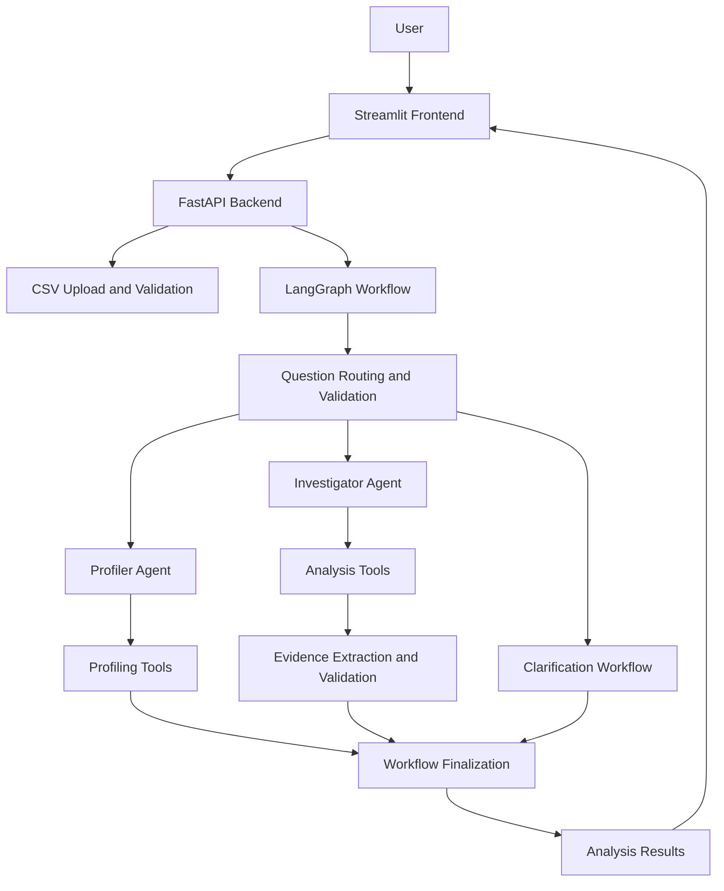
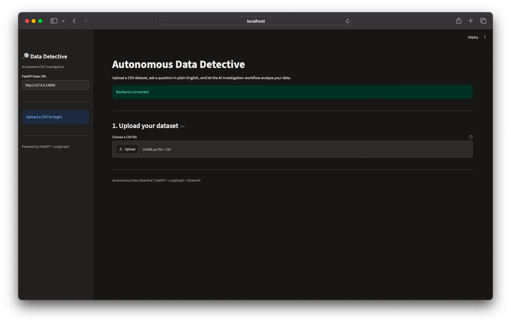
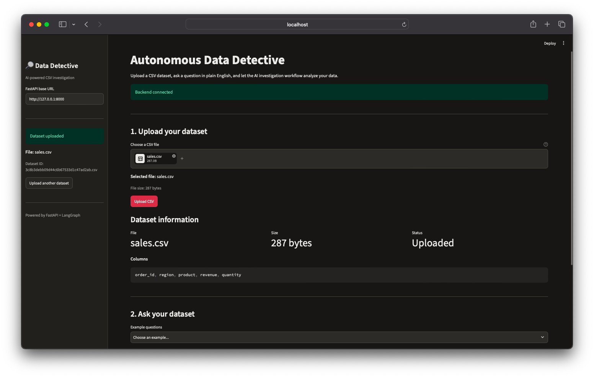
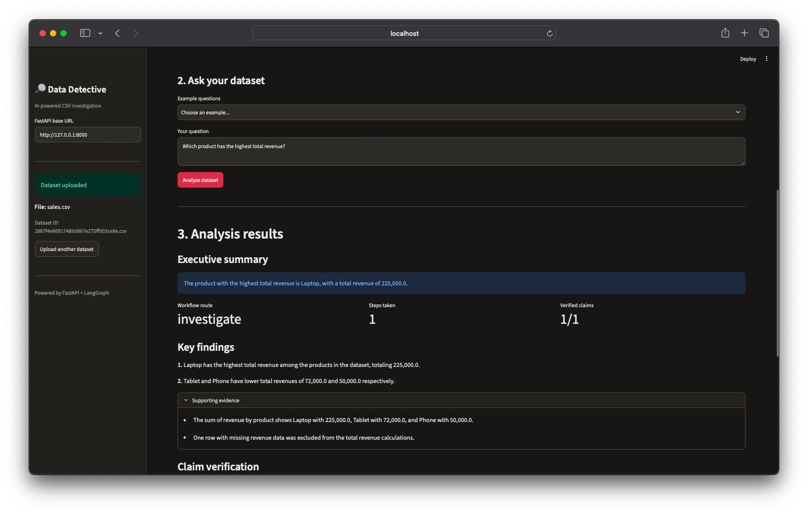
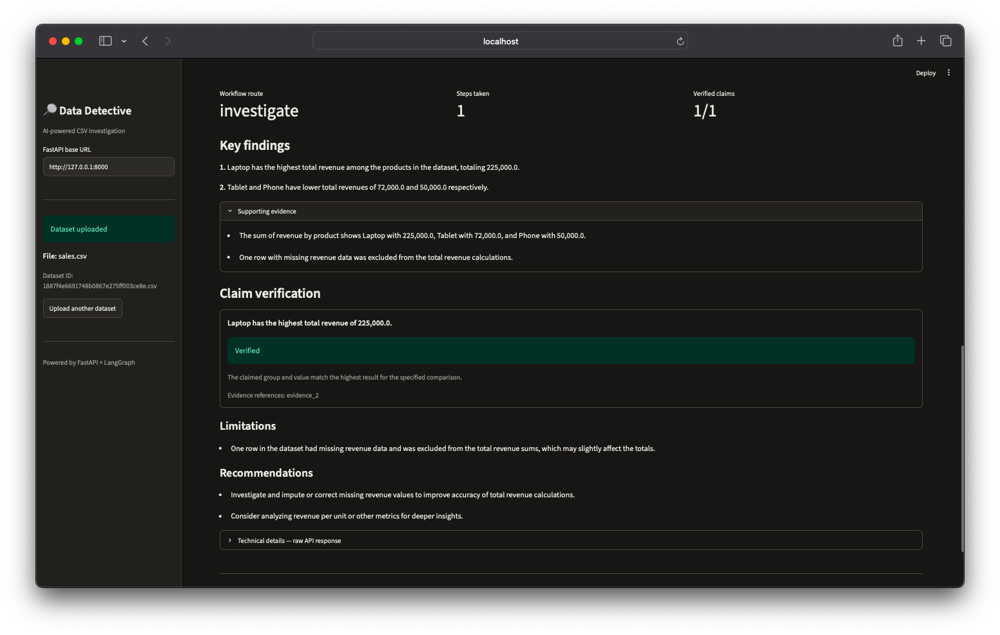

# Autonomous Data Detective

**An AI-powered data analysis agent built with Python, LangGraph, LangChain, FastAPI, and Streamlit.**

Autonomous Data Detective is an agentic AI application that analyzes CSV datasets, understands natural-language questions, selects appropriate analysis workflows, invokes data-analysis tools, and validates factual claims against supporting evidence.

The project demonstrates how LLM-powered agents can be combined with deterministic data-processing tools and evidence validation to build more reliable data-analysis workflows.

## Key Features

- **Automated dataset profiling:** Summarizes dataset structure, statistics, missing values, and duplicate rows.
- **Natural-language analysis:** Allows users to ask questions about uploaded CSV datasets.
- **Intelligent workflow routing:** Routes questions to profiling, investigation, combined analysis, or clarification workflows.
- **Tool-based analysis:** Supports numerical statistics, missing-value analysis, group comparisons, and correlation analysis.
- **Evidence-based claim validation:** Checks factual claims against matching tool outputs and marks unsupported claims as unverifiable.
- **Input validation:** Rejects invalid CSV uploads, malformed rows, empty datasets, and oversized files.
- **Error handling:** Records workflow failures and preserves successful results when possible.
- **Interactive interface:** Uses Streamlit for the user interface and FastAPI for backend API endpoints.
- **Automated testing:** Includes unit and integration tests for tools, routing, evidence validation, API behavior, and graph workflows.

## Architecture



## Technology Stack

| Component | Technology |
|---|---|
| Programming language | Python |
| Agent orchestration | LangGraph |
| LLM and tool integration | LangChain |
| Language model | OpenAI `gpt-4.1-mini` |
| Backend API | FastAPI |
| Frontend | Streamlit |
| Data processing | Pandas and Python data-analysis libraries |
| Data validation | Pydantic |
| Testing | Pytest |

## How It Works

1. The user uploads a CSV dataset through the Streamlit interface.
2. The FastAPI backend validates the uploaded file and assigns it a generated dataset identifier.
3. The user submits a question in natural language.
4. The LangGraph workflow routes the question to the appropriate processing path.
5. The profiler or investigator uses the available tools to inspect and analyze the dataset.
6. For investigation claims, the application matches claims to relevant tool evidence and validates supported numerical, group-comparison, and correlation results.
7. The workflow prepares the final response and returns the results to the interface.

## Example Questions

Given a dataset containing columns such as `department`, `salary`, and `revenue`, users can ask:

- What is the average salary?
- What is the median salary?
- Which department has the highest average salary?
- Are there missing values or duplicate rows?
- What is the correlation between salary and revenue?
- What is the average bonus? *(If the dataset does not contain a bonus column, the system should reject or clarify the request.)*
- Which department is best? *(The system can request clarification when the evaluation criterion is ambiguous.)*

The available analysis depends on the columns and data in the uploaded CSV.

## Getting Started

### Prerequisites

- Python 3.12
- `uv` package manager
- An OpenAI API key

### 1. Clone the repository

```bash
git clone <YOUR_REPOSITORY_URL>
cd autonomous-data-detective
```

Replace `<YOUR_REPOSITORY_URL>` with your actual Git repository URL.

### 2. Install dependencies

```bash
uv sync
```

### 3. Configure environment variables

Create a `.env` file in the project root and configure your OpenAI API key using the environment variable name expected by the project's configuration.

**Important:** Never commit your `.env` file or expose API keys in source code.

### 4. Start the backend

```bash
uv run uvicorn autonomous_data_detective.api.main:app --reload --app-dir src
```

The FastAPI service should be available at:

- API: `http://127.0.0.1:8000`
- Interactive API documentation: `http://127.0.0.1:8000/docs`
- Health check: `http://127.0.0.1:8000/health`

### 5. Start the frontend

Open a second terminal from the project root and run:

```bash
uv run streamlit run frontend/app.py
```

Open the local URL printed by Streamlit.

## Running Tests

Run the complete test suite:

```bash
uv run pytest
```

The latest verified result during development was **260 tests passed**.

The test suite covers:

- Dataset profiling and data-analysis tools
- Question validation and workflow routing
- Structured investigation reports
- Evidence extraction and factual-claim validation
- Graph integration, failure handling, and step limits
- API endpoints and CSV upload validation

## Project Structure

```text
autonomous-data-detective/
├── src/
│   └── autonomous_data_detective/
│       ├── agents/
│       ├── api/
│       ├── graph/
│       ├── tools/
│       └── core/
├── frontend/
│   └── app.py
├── tests/
│   ├── unit/
│   └── integration/
├── data/
├── pyproject.toml
├── uv.lock
└── README.md
```

This is a high-level overview; update it if your actual repository structure differs.

## Engineering Highlights

- Graph-based agent orchestration with LangGraph
- Separation of LLM reasoning and deterministic data-analysis tools
- Structured outputs for investigation reports and factual claims
- Evidence matching and validation before claims are presented as verified
- Input validation and controlled API error responses
- Unit and integration testing for reliability and regression prevention

## Future Improvements

Potential areas for further development include:

- More comprehensive evaluation across diverse real-world datasets
- Structured evidence verification for profiling responses
- Retrieval and analysis of larger datasets
- Observability, execution tracing, and performance monitoring
- Deployment with appropriate authentication, resource limits, and operational monitoring

## Disclaimer

This project is a portfolio and engineering demonstration. Passing automated tests does not guarantee that every possible dataset or model-generated response will be correct. Results should be reviewed before being used for consequential business decisions.


## Application Screenshots

### Application Overview

See the application interface and dataset upload workflow.



### Dataset Profiling

Inspect dataset dimensions, missing values, and available profiling results.



### Investigation Summary

View the AI-generated findings and the product with the highest total revenue.



### Claim Verification

Review the evidence and verification status associated with the investigation.

